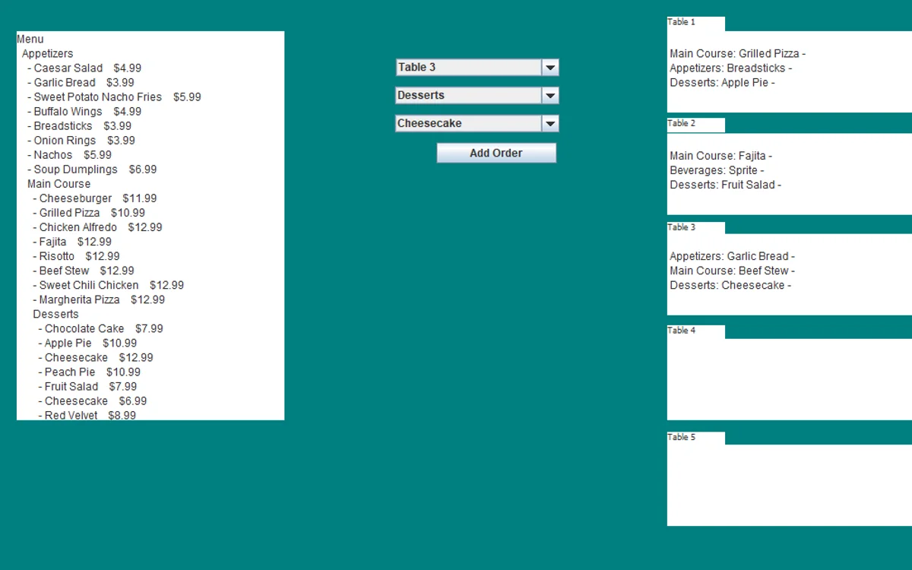

# Online Food Delivery & Order Management System

A Java-based desktop application tailored for single-location restaurants to streamline menu navigation and expedite table order management.

---

## 📌 Features

* **Hierarchical Menu Management:** Easy category and subcategory navigation for smooth menu browsing.
* **Fair Order Processing:** Sequential order handling for balanced kitchen and service workflows.
* **Interactive Graphical UI:** Built using Java Swing for an intuitive interface for both staff and customers.
* **Table & System Control:** Features for placing orders, arranging tables, and viewing live restaurant status.

---

## 🛠️ Data Structures Applied

* **Tree Data Structure:** Organizes the restaurant menu hierarchically. Each node represents a category or subcategory, making menu updates and traversals fast and efficient.
* **Queue Data Structure:** Manages incoming orders in a First-In, First-Out (FIFO) sequence. Ensures equitable order queuing and smooth operational flow during peak hours.

---

## 💻 Tech Stack

* **Language:** Java
* **GUI Framework:** Java Swing
* **IDE:** Eclipse

---

## 🚀 Getting Started

### Prerequisites

* **Java Development Kit (JDK):** Version 8 or higher
* **IDE:** Eclipse (recommended) or any Java-compatible IDE

### How to Run

1. Open the cloned project in **Eclipse IDE** (or your preferred Java IDE).
2. Locate `Main.java` or `OrderManagement.java` in the project explorer.
3. Right-click the file and select **Run As -> Java Application**.

---

## 👥 Author

* **Okan Umut Özen**

--